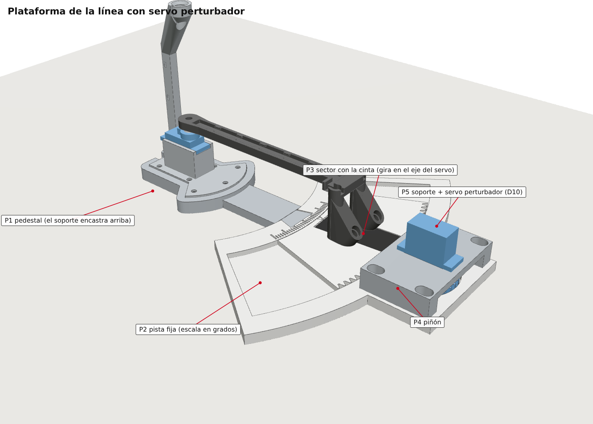

# Banco de pruebas PID v3: brazo seguidor de línea con servos SG90

Es un banco para probar controladores PID con un caso real.

- Un servo SG90 (D9) gira un brazo de 120 mm entre 60° y 120°.
- En la punta, un cabezal con 2 LDR y 2 LED mide dónde está una línea negra.
- La línea va sobre un sector giratorio que mueve un **segundo servo, el perturbador** (D10). Así las perturbaciones son exactas y repetibles.
- El Arduino Nano corre un PID configurable (P, PI, PD o PID).
  - Cada mejora del controlador se puede prender y apagar para comparar.
  - Los ensayos son guiados: escalón de perturbación, escalón de referencia, rampa, senoidal y servo a lazo abierto.
- Un panel web (Chrome/Edge, Web Serial) muestra todo en vivo, calcula las métricas y compara los ensayos.



## Contenido

```
1_DISENO_3D/
├── impresion/          Lo que se manda a imprimir (entregar esta carpeta tal cual)
│   ├── 01_brazo_L120.stl              Brazo de 120 mm (eje del servo -> centro de los LDR)
│   ├── 02_base_L120.stl               Soporte del servo con pie y torre guía de cables
│   ├── 03_pedestal.stl                El soporte encastra arriba; une con la pista
│   ├── 04_pista_BLANCO.stl            Arco fijo con canal, escala y lugar del piñón   (PLA blanco)
│   ├── 05_sector_linea_BLANCO.stl     Sector que gira con la cinta y la cremallera    (PLA blanco)
│   ├── 06_pinon.stl                   Piñón de 32 dientes para el horn del perturbador
│   ├── 07_soporte_perturbador.stl     Puente que sostiene el servo perturbador boca abajo
│   ├── INSTRUCCIONES_DE_IMPRESION.pdf / .txt
│   ├── orientacion_de_impresion.png
│   └── referencia_ensamble.png
├── variantes/          Todo lo que generan los modelos
│   ├── brazo_L100 / L120 / L150.stl, base_apoyo_libre_L100 / L120 / L150.stl
│   ├── base_compacta_atornillar.stl  Más chica; SE VUELCA si no se atornilla (4 × M3)
│   └── plataforma/                   P1..P5 tal como salen de plataforma.py
├── modelo/
│   ├── seguidor.py           Brazo y soporte paramétricos (genera y verifica)
│   ├── plataforma.py         Plataforma, engranaje y perturbador (usa seguidor.py)
│   ├── COMO_REGENERAR.txt
│   ├── ensamble_3D.glb       Brazo + soporte armados
│   └── plataforma_3D.glb     Conjunto completo con la plataforma
├── imagenes/           Renders: conjunto, cabezal, montaje del horn, ranura del cable, plataforma
└── calculos/           RESUMEN.txt, salida_del_script.txt, salida_plataforma.txt

2_PLANOS/
├── Planos_Banco_PID.pdf   6 hojas A3: servo · soporte · brazo y cabezal · conjunto ·
│                          esquema eléctrico (2 servos) · plataforma y perturbador
├── hoja1 … hoja6 (.png)
└── fuente/                planos.py + lib_plano.py

3_FIRMWARE_Y_PANEL/
├── banco_pid_v3/banco_pid_v3.ino   Firmware para el Arduino Nano
├── banco_pid_v3.hex                El mismo, ya compilado
├── panel_v3.html                   Panel (Chrome/Edge). Botón Demo: sesión simulada completa
├── LEEME_FIRMWARE.txt              Conexiones, carga, uso del panel, órdenes, pruebas
├── panel/                          Fuente del panel + script que le agrega la demo
├── pruebas_simulacion/             Simulación física del firmware (31 chequeos) y resultados
└── anteriores/seguidor_v2/         Versión anterior (solo seguidor), como referencia
```

## El panel, en el orden en que se usa

| Pestaña | Para qué |
|---|---|
| 1 · Sensores | Lecturas crudas y corregidas, avisos de saturación, calibración del brazo y del perturbador con diagnóstico (contraste, desfase entre LDR, zona lineal). Corrección de los LDR: sin igualar, automática o manual (ganancia y offset, el "potenciómetro digital"). |
| 2 · Servo y línea | Mover el brazo y la línea, fijar el cero, trim del horn, engranaje. Identificación del servo a lazo abierto. |
| 3 · Controlador | Tipo P/PI/PD/PID, Kp/Ki/Kd, derivativo sobre error o medición. Interruptores: anti-windup, límite de velocidad, zona muerta, refuerzo, búsqueda. Presets. |
| 4 · Ensayos | Elegir el ensayo, ejecutarlo y ver el registro (respuesta, error, P/I/D) y las métricas: subida, sobrepaso, establecimiento, error final, IAE, ISE; ganancia y fase en la senoidal. |
| 5 · Resultados | Tabla de todos los ensayos, superposición de hasta 4, exportación a CSV. |

Siempre visibles:
- **Arriba:** estado, calibraciones, "cambios sin guardar" con Guardar/Recargar, y **STOP**.
- **Franja en vivo:** brazo, línea, s, p, error, salida del PID y lecturas de los LDR.

## Regenerar

```bash
pip install manifold3d trimesh numpy rtree matplotlib
python3 1_DISENO_3D/modelo/seguidor.py          # brazo y soporte -> 1_DISENO_3D/variantes/
python3 1_DISENO_3D/modelo/plataforma.py        # plataforma     -> 1_DISENO_3D/variantes/plataforma/
python3 2_PLANOS/fuente/planos.py               # PDF y PNG      -> 2_PLANOS/

cd 3_FIRMWARE_Y_PANEL/pruebas_simulacion
g++ -std=c++17 -O2 -Imock sim.cpp -o sim && ./sim       # DEMO=1 ./sim regenera demo.txt
python3 ../panel/construir_panel.py                     # vuelve a armar panel_v3.html con la demo
```

## Lista de materiales (no impresos)

| Cant. | Pieza |
|---|---|
| 2 | Servos SG90. Brazo: horn de **un** brazo. Perturbador: cualquiera de los tres horn (un brazo, recto o cruz) |
| 2 | Tornillos autorroscantes de 2 × 6 mm (horn del brazo y horn del piñón) |
| 4 | Tornillos M2 autorroscantes (vienen con los servos) para las orejas |
| 9 | Tornillos M3 × 8 autorroscantes: 5 fijan el soporte al pedestal y 4 fijan el soporte del perturbador |
| 2 | LDR GL5528 de 5 mm + 2 resistencias de 4,7 kΩ |
| 2 | LED blancos de 5 mm + 2 resistencias (150–220 Ω) |
| 1 | Electrolítico de 470–1000 µF + cerámico de 100 nF; fuente de 5–6 V y **2 A** para los servos |
| 1 | Cinta aisladora negra de 19 mm (la línea) |
| 10 | Cables del brazo (hoy cable de red; a futuro, multifilar 24 AWG) |
| — | Termocontraíble, 2–4 precintos de 2,5 mm, silicona caliente o cinta negra |

## Armado

1. **Brazo y soporte** (detalle abajo): servo en el soporte, LDR y LED en el cabezal, cables por el canal y el anillo, horn y brazo.
2. **El cable del servo del brazo** se acuesta en la ranura abierta de atrás del soporte ([imagen](1_DISENO_3D/imagenes/11_ranura_cable_servo.png)).
3. **Pedestal y pista**: la cola de milano del pedestal entra desde arriba en la pista. El soporte encastra en el pedestal y se fija con 5 M3.
4. **Sector**: pegar la cinta negra en el canal radial. Poner el sector en el canal de la pista; tiene que girar a mano sin trabarse.
5. **Perturbador**:
   1. Con el servo en 90°, poner el horn (de un brazo, recto o en cruz: el piñón acepta los tres, [imagen](1_DISENO_3D/imagenes/15_pinon_horns.png)) y el piñón encima, con el tornillo de 2 × 6 desde abajo. Con el horn en cruz conviene una gota de cianoacrilato entre horn y piñón.
   2. Poner el servo boca abajo en su soporte (orejas con M2).
   3. Bajar el soporte sobre la pista engranando el piñón con el sector, y atornillarlo con 4 M3 por las ranuras. Corriéndolo 3 mm se desengrana.
6. **Cables**: los del brazo como antes. Los dos servos van a la salida de la alimentación, con las señales en D9 (brazo) y D10 (línea). Ver la [hoja 5](2_PLANOS/hoja5_esquema.png).
7. **En el panel**:
   1. 1 · Sensores → Calibrar con el brazo, después Calibrar el perturbador.
   2. Guardar en la placa.
   3. 3 · Controlador → Seguir la línea.
   4. 4 · Ensayos.

<details><summary><b>Detalle: brazo y soporte</b></summary>

1. **Ajuste del horn en el brazo** (holgura de 0,10 mm por lado). Si entra muy duro, repasar el borde del hueco con lija fina. Si queda flojo, usar la gota de cianoacrilato del paso 7.4. Solo si nada de eso sirve, cambiar `HORN_CLR` en `seguidor.py` (0,05 si quedó flojo, 0,20 si no entró) y reimprimir el brazo.
2. **Servo del brazo en 90°** antes de montar el brazo (el firmware va a 90° al encender).
3. **Servo en el soporte**: entra desde arriba; se atornillan las orejas (M2) y el cable se acuesta en la ranura abierta.
4. **LDR**: entra por arriba de su cabina, con la cara sensible hacia abajo, hasta el tope (queda a 8 mm del piso del cabezal). Las patitas salen por la ranura hacia el brazo.
5. **LED**: entra por el techo inclinado hasta que el reborde apoya en el escalón. Tapar la boca superior de cada cabina con silicona o cinta negra.
6. **Cables**: van por el canal transversal del cabezal y el canal del brazo (6 abajo y 4 arriba, a presión bajo las pestañas). Suben junto al eje, pasan el anillo guía por la ranura de 1,4 mm y bajan por la torre hasta la placa.
   - Con cable de red, dejar al menos 15 cm suelto después del anillo y no usar los precintos.
7. **Horn y brazo** ([imagen](1_DISENO_3D/imagenes/10_montaje_horn_brazo_tornillo.png)):
   1. El horn de un brazo va con el **cubo hacia abajo** (hacia el servo), apuntando al frente.
   2. El brazo baja sobre el horn.
   3. Tornillo de 2 × 6 desde arriba, a través del anillo (entra unos 3,4 mm en el eje).
   4. Opcional: una gota de cianoacrilato entre el horn y el brazo (no en el eje).
8. **Comprobar a mano** el barrido de 60° a 120°: el brazo no toca nada y los cables no tiran.

</details>

Detalle de uso, órdenes y pruebas: [`3_FIRMWARE_Y_PANEL/LEEME_FIRMWARE.txt`](3_FIRMWARE_Y_PANEL/LEEME_FIRMWARE.txt).

## Conexiones

- LDR izquierdo: 5V – LDR – A0 – 4,7 kΩ – GND · LDR derecho: igual en A1.
- LED blancos: 5V – resistencia – LED – GND. Opcional: el + a D5/D6 para regular el brillo desde el panel.
- Servo del brazo: señal D9 · Servo de la línea: señal D10.
- Alimentación de los servos: entrada → C1 y C2 en paralelo → salida a los dos servos. Del negativo, en los capacitores, un cable al GND del Arduino.
