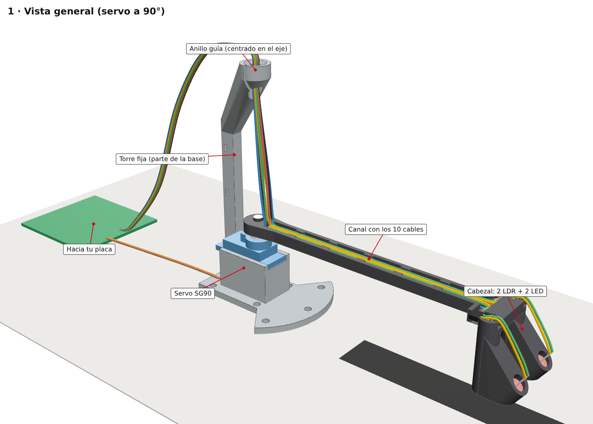

# Banco de pruebas PID v2 — seguidor de línea estático con servo SG90

Un servo SG90 gira un brazo de 120 mm entre 60° y 120°. En la punta, un cabezal con 2 LDR y 2 LED
detecta una línea negra y el Arduino Nano la sigue con un control PI que trabaja sobre el lazo interno del servo.



## Contenido

```
1_DISENO_3D/
├── impresion/          Lo que se manda a imprimir (entregar esta carpeta tal cual)
│   ├── 01_brazo_L120.stl              Brazo de 120 mm (eje del servo -> centro de los LDR)
│   ├── 02_base_L120.stl               Base con pie antivuelco y torre guía de cables
│   ├── INSTRUCCIONES_DE_IMPRESION.pdf Material, parámetros, orientación, medidas críticas
│   ├── INSTRUCCIONES_DE_IMPRESION.txt Lo mismo en texto
│   ├── orientacion_de_impresion.png
│   └── referencia_ensamble.png
├── variantes/          Todos los STL que genera el modelo
│   ├── brazo_L100 / L120 / L150.stl
│   ├── base_apoyo_libre_L100 / L120 / L150.stl   Se sostiene sola (una por cada largo de brazo)
│   └── base_compacta_atornillar.stl              Más chica; SE VUELCA si no se atornilla (4 × M3)
├── modelo/
│   ├── seguidor.py           Modelo paramétrico: regenera todos los STL y verifica choques
│   ├── COMO_REGENERAR.txt
│   └── ensamble_3D.glb       Conjunto armado (Visor 3D de Windows o https://gltf-viewer.donmccurdy.com)
├── imagenes/           Renders del conjunto, cortes del cabezal, montaje del horn, ranura del cable
└── calculos/
    ├── RESUMEN.txt              Cálculos y decisiones de diseño
    └── salida_del_script.txt    Verificación de choques, estabilidad y esfuerzos

2_PLANOS/
├── Planos_Seguidor_SG90.pdf    5 hojas A3 acotadas: servo · soporte · brazo y cortes del cabezal ·
│                               conjunto · esquema eléctrico
├── hoja1 … hoja5 (.png)
└── fuente/                     planos.py + lib_plano.py (generan el PDF desde el modelo)

3_FIRMWARE_Y_PANEL/
├── seguidor_v2/seguidor_v2.ino  Firmware para el Arduino Nano
├── seguidor_v2.hex              El mismo, ya compilado
├── panel_v2.html                Panel de control (Chrome/Edge, Web Serial). Botón Demo sin placa
├── LEEME_FIRMWARE.txt           Conexiones, carga, calibración, ajuste y órdenes
└── pruebas_simulacion/          Simulación en la PC con la que se probó el firmware (16 chequeos)
```

## Regenerar

```bash
pip install manifold3d trimesh numpy rtree matplotlib
python3 1_DISENO_3D/modelo/seguidor.py          # STL en 1_DISENO_3D/variantes/
python3 2_PLANOS/fuente/planos.py               # PDF y PNG en 2_PLANOS/

cd 3_FIRMWARE_Y_PANEL/pruebas_simulacion
g++ -std=c++17 -O2 -Imock sim.cpp -o sim && ./sim
```

## Lista de materiales (no impresos)

| Cant. | Pieza |
|---|---|
| 1 | Servo SG90 + su horn de **un** brazo (el más corto, 19,6 mm de largo total) |
| 1 | Tornillo autorroscante de 2 × 6 mm para el horn (el que trae el servo suele ser corto) |
| 2 | Tornillos M2 autorroscantes (vienen con el servo) para las orejas |
| 4 | Tornillos M3 (opcional: fijar la base) |
| 2 | LDR GL5528 de 5 mm |
| 2 | LED de 5 mm (blanco o verde) + 2 resistencias |
| 2 | Resistencias para los LDR (hoy 4,7 kΩ) |
| 1 | Electrolítico 470–1000 µF + cerámico 100 nF para la alimentación del servo |
| 10 | Cables (hoy: cable de red; a futuro: multifilar 24 AWG) |
| — | Termocontraíble fino, 2–4 precintos de 2,5 mm, silicona caliente o cinta negra |

## Armado

1. **Ajuste del horn en el brazo** (holgura de 0,10 mm por lado):
   - Entra firme: perfecto.
   - Entra muy duro o no entra: repasar el borde del hueco con lima o lija fina, de a poco.
   - Queda flojo: la gota de cianoacrilato del paso 8 d) lo deja sin juego.
   - Solo si nada de eso sirve: cambiar `HORN_CLR` en `seguidor.py` (0,05 si quedó flojo, 0,20 si no
     entró) y reimprimir el brazo.
2. **Servo en 90°** antes de montar el brazo (el firmware v2 va a 90° al encender, o "Ir a 90" en el panel).
3. **Servo en la base**: entra desde arriba; atornillar las orejas (M2). El cable del servo (ya soldado a la
   placa) se acuesta desde arriba en la ranura abierta de atrás, del lado opuesto a la torre
   ([imagen](1_DISENO_3D/imagenes/11_ranura_cable_servo.png)). No hay que pasarlo por un agujero.
4. **LDR**: entra por arriba de su cabina, cara sensible hacia abajo, hasta hacer tope. Queda a 8,0 mm del
   piso (1 mm por encima de la boca). Las patitas salen por la ranura hacia el brazo; empalmar con termocontraíble.
5. **LED**: entra por el agujero del techo inclinado hasta que el reborde apoya en el escalón.
6. Tapar la boca superior de cada cabina con silicona caliente o cinta negra (la luz debe entrar solo por abajo).
7. **Cables**: canal transversal del cabezal → canal del brazo (6 abajo + 4 arriba, a presión bajo las
   pestañas) → suben junto al eje → anillo guía (a presión por la ranura de 1,4 mm) → torre → placa.
   - Cable de red (rígido): **no** usar los precintos de la torre; dejar el cable suelto al menos 15 cm
     después del anillo (si no, carga al servo ~13 %).
   - Cable multifilar: se pueden usar los precintos (carga ~2 %).
8. **Horn y brazo** ([imagen](1_DISENO_3D/imagenes/10_montaje_horn_brazo_tornillo.png)):
   1. Con el servo en 90°, encajar el horn de un brazo en el eje estriado: el **cubo** va **hacia abajo**
      (hacia el servo) y la paleta queda arriba. Apuntarlo al frente (hacia el pie de la base); el estriado da
      saltos de ~17°, el resto se corrige con `trim` en el firmware.
   2. Bajar el brazo sobre el horn: la cara superior del horn entra en el hueco de la cara de abajo del brazo.
   3. Tornillo de 2 × 6 mm desde arriba, a través del anillo de la torre: la cabeza queda en el avellanado y
      entra ~3,4 mm en el eje. Apretar sin forzar.
   4. Opcional, para cero juego: una gota de cianoacrilato entre horn y brazo (no en el eje).
9. Comprobar a mano el barrido 60°–120°: el brazo no debe tocar nada y los cables no deben tirar.

Después: cargar el firmware y calibrar siguiendo [`3_FIRMWARE_Y_PANEL/LEEME_FIRMWARE.txt`](3_FIRMWARE_Y_PANEL/LEEME_FIRMWARE.txt).

## Conexiones (cableado actual)

Esquema completo en la hoja 5 de los planos ([PNG](2_PLANOS/hoja5_esquema.png)).

- LDR izquierdo: 5V – LDR – A0 – 4,7 kΩ – GND · LDR derecho: igual en A1
- LED blancos: 5V – resistencia – LED – GND (para regular brillo desde el firmware, pasar el + a D5/D6)
- Servo: señal en D9. Alimentación aparte: entrada → C1 y C2 en paralelo → salida al servo; del negativo,
  en los capacitores, un cable al GND del Arduino.
